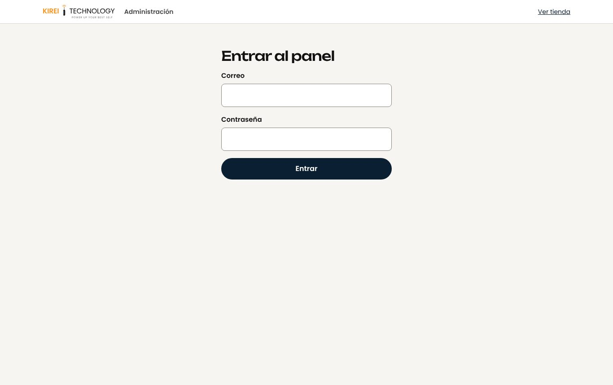

# Kirei Technology

Tienda en línea de Kirei Technology, en Panamá Oeste. Vende audífonos, relojes inteligentes y accesorios, tiene una zona Anime y agenda reparaciones de computadoras. La compra se confirma por WhatsApp y se paga con Yappy o contra entrega.


| Catálogo | Móvil | Panel admin |
| --- | --- | --- |
|  |  |  |

## Qué hace

- **Tienda:** catálogo con buscador, filtros y orden; carrusel de marcas; detalle de producto con colores u opciones (cada una puede tener su precio) y comentarios; carrito guardado en el navegador. Las unidades disponibles solo las ve el admin; el cliente ve "Solo quedan N unidades" cuando son menos de 3.
- **Checkout:** retiro gratis, punto de encuentro o envío a domicilio. Cada pedido recibe un número único (`KT-1001`, `KT-1002`...) y se abre WhatsApp con el resumen.
- **Cuentas de clientes:** correo y contraseña, Google o Apple. Mis pedidos con su estado y recibo, favoritos, direcciones, descargar mis datos y eliminar la cuenta.
- **Reparaciones:** lista de servicios y formulario de cita que se envía por WhatsApp y queda registrado.
- **Panel `/admin`:** productos (con subida de fotos), pedidos (aviso de precio distinto al catálogo y descuento de unidades al confirmar), citas, clientes, equipo de administradores y moderación de comentarios. Con sesión de admin, la tienda muestra arriba un botón para volver al panel.
- **Monitoreo:** Sentry opcional (`VITE_SENTRY_DSN`), sin IP ni datos personales.
- **Legal:** política de privacidad y términos según la ley de Panamá (Ley 81 de 2019 y Ley 45 de 2007).

## Tecnología

| Parte | Herramienta |
| --- | --- |
| Interfaz | React 19, Vite 8, wouter (rutas), CSS Modules, Motion |
| Datos y cuentas | Firebase: Firestore, Authentication, Hosting |
| Fotos subidas desde el panel | Cloudinary (subida sin firma) |
| Pruebas | `node --test` y el emulador de Firestore |

Sin Firebase configurado, la tienda funciona igual con los datos de `src/data/`. Sirve para trabajar sin conexión a la base real.

## Empezar

Requisitos: Node.js (probado con la versión 24) y, para las pruebas de reglas, Java.

```bash
npm install
cp .env.example .env.local   # llena los valores de Firebase y Cloudinary
npm run dev                  # http://localhost:5173
```

`.env.local` no se sube al repositorio. Solo lleva datos públicos de la web; la seguridad real está en `firestore.rules`. La clave secreta de Cloudinary nunca va en este proyecto.

## Comandos

| Comando | Para qué |
| --- | --- |
| `npm run dev` | Servidor de desarrollo con recarga automática |
| `npm run build` | Compila la tienda en la raíz del repositorio (`index.html` y `assets/`), para Firebase |
| `npm run build:pages` | Compila la versión de GitHub Pages en `_pages/` (vive en `/KIREITECHNOLOGY/`) |
| `npm run preview` | Sirve la versión compilada para revisarla |
| `npm test` | Pruebas de lógica: precios, pedidos, validaciones, datos y contraste |
| `npm run test:reglas` | Pruebas de `firestore.rules` contra el emulador, incluido el aislamiento entre cuentas (necesita Java) |
| `npm run test:e2e` | Pruebas en Chrome de los flujos de compra, en escritorio y celular, sin tocar la base real |
| `npm run test:e2e:emulador` | Dos cuentas reales en los emuladores: una no ve los pedidos de la otra ni entra al panel (necesita Java) |
| `powershell -File scripts/fotos-web.ps1` | Crea las copias livianas de las fotos nuevas de `Productos/` y `reparaciones/` |

## Publicar

```bash
npm run build
npx firebase-tools deploy --only firestore:rules,hosting
```

GitHub Pages se publica solo en cada push a `main` con `.github/workflows/pages.yml`: [jmmm11.github.io/KIREITECHNOLOGY](https://jmmm11.github.io/KIREITECHNOLOGY/).

Los pasos completos, cómo volver a una versión anterior y qué hacer si algo falla están en [docs/OPERACION.md](docs/OPERACION.md).

## Documentación

| Documento | Contenido |
| --- | --- |
| [Arquitectura](docs/ARQUITECTURA.md) | Diagramas del sistema, carpetas, base de datos y flujos de compra y comentarios |
| [Estados de cada pantalla](docs/ESTADOS.md) | Qué ve el cliente mientras carga, si no hay datos y si algo falla |
| [Seguridad y privacidad](docs/SEGURIDAD.md) | Reglas de acceso, encabezados, secretos y controles pendientes |
| [Operación](docs/OPERACION.md) | Publicar, revertir, respaldos y guía de incidentes |
| [Auditoría](docs/AUDITORIA.md) | Hallazgos, correcciones, pruebas y métricas medidas |
| [Reportar una vulnerabilidad](SECURITY.md) | A quién avisar si encuentras un problema de seguridad |

Diagrama automático del repositorio: [gitdiagram.com/JMMM11/KIREITECHNOLOGY](https://gitdiagram.com/JMMM11/KIREITECHNOLOGY).

## Contacto

WhatsApp +507 6156 0839 · Instagram [@kireitechnology](https://www.instagram.com/kireitechnology/)
