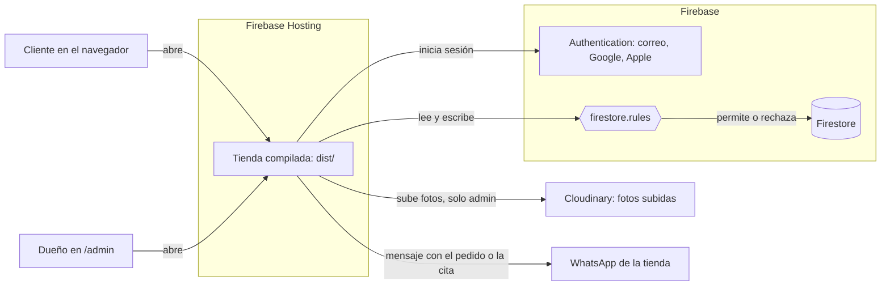
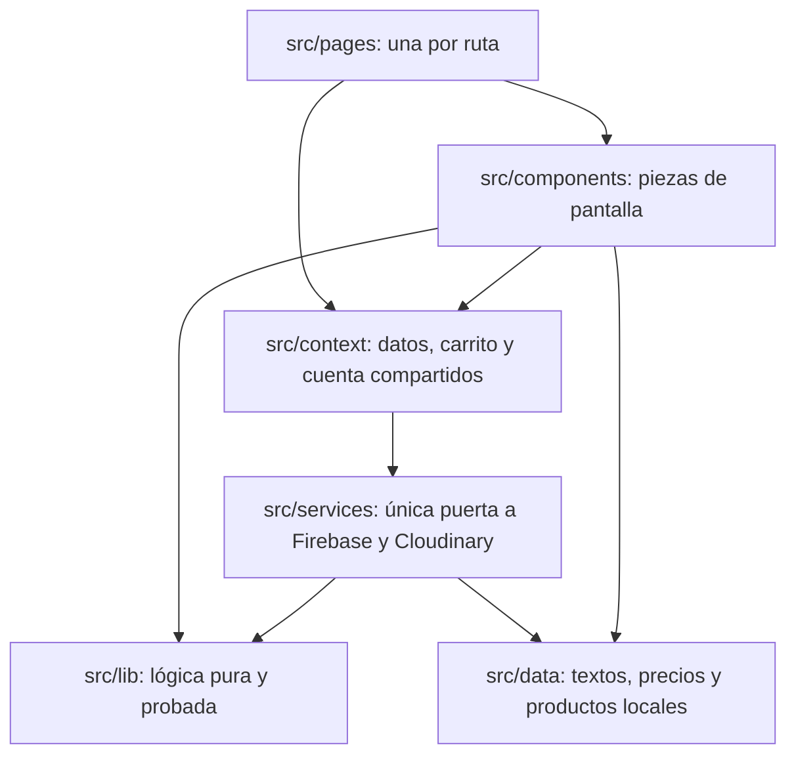
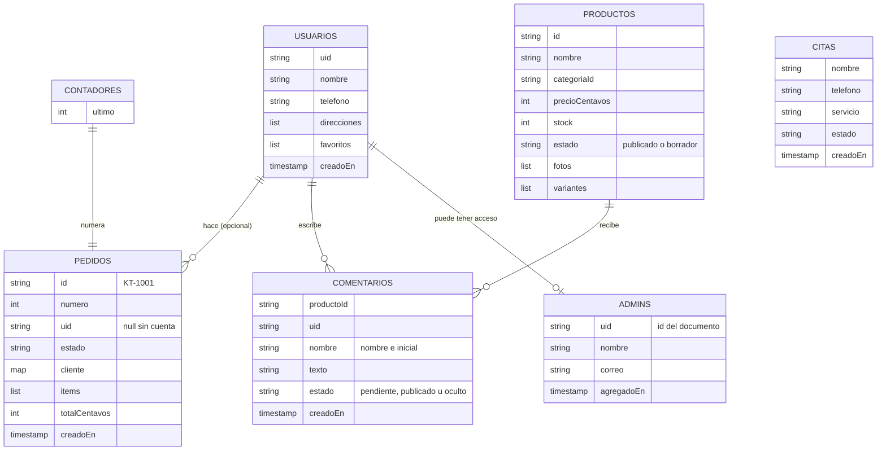
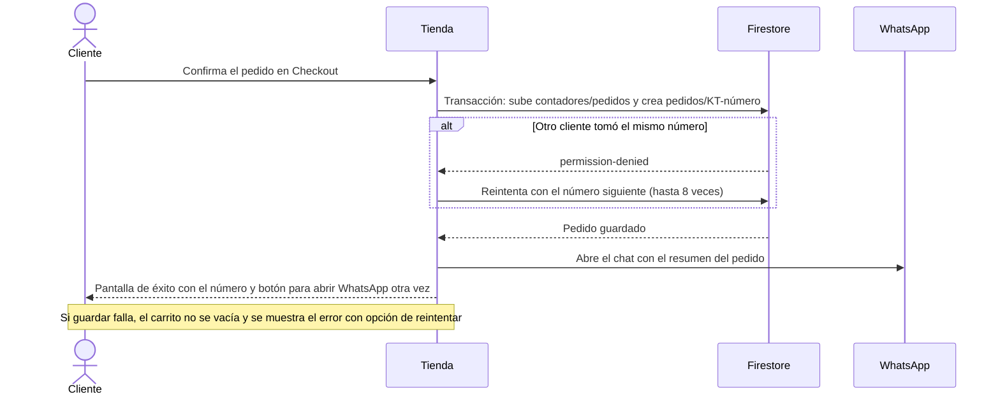
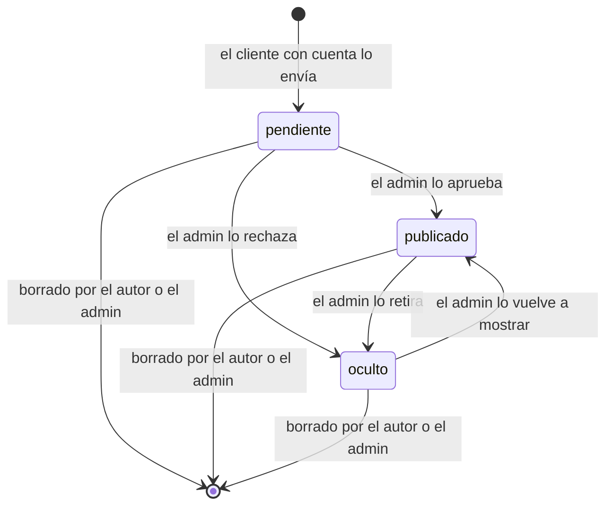

# Arquitectura

La tienda es una aplicación de una sola página (SPA) en React. No tiene servidor propio: el navegador habla directo con Firebase, y las reglas de Firestore deciden qué puede leer o escribir cada persona.

## Vista general

## Capas del código

| Carpeta | Qué hay |
| --- | --- |
| `src/pages` | Inicio, Catálogo, Producto, Carrito, Checkout, Anime, Reparaciones, Ayuda, Legal, Cuenta, Admin y 404 |
| `src/components/admin` | Panel: productos, pedidos, citas, clientes y comentarios |
| `src/components/cuenta` | Acceso, Mis pedidos, perfil, favoritos, direcciones y seguridad |
| `src/components/tienda` | Tarjetas, detalle, carrito, comentarios y precios |
| `src/components/ui` | Piezas reutilizables: fotos, campos, esqueletos de carga, pantallas de estado |
| `src/components/layout` | Encabezado, pie, navegación móvil, límite de errores y aviso de conexión |
| `src/context` | `DatosContext` (productos), `CarritoContext`, `CuentaContext` |
| `src/services` | `tienda.js` decide si los datos vienen de Firestore o de `src/data/` |
| `src/lib` | Totales, validaciones, armado de pedidos y citas, formato de precios |
| `src/data` | Textos de la tienda, tarifas, productos y textos legales |
| `tests/` | Pruebas de lógica; `tests/reglas/` prueba `firestore.rules` |
| `public/` | Archivos que se copian tal cual: logo, fuentes, íconos, `robots.txt`, `sitemap.xml` |
| `Productos/`, `reparaciones/` | Fotos originales de productos y servicios |

La compilación (`scripts/compilar.mjs`) va a `dist/`, que es lo que publica Firebase Hosting, o a `_pages/` para GitHub Pages. Copia las fotos livianas (`web/`) y genera `sitemap.xml` y `robots.txt` con `SITIO.url`. Los originales de las fotos, el código fuente y las pruebas no se publican.

## Base de datos

Los precios se guardan en centavos (enteros) para evitar errores de redondeo.

## Flujo de un pedido

Después, el dueño cambia el estado en `/admin > Pedidos` (recibido, confirmado, enviado, entregado o cancelado) y el cliente con cuenta lo ve en Mis pedidos.

## Flujo de un comentario

Solo los comentarios `publicado` se ven en la tienda. Al eliminar su cuenta, el cliente borra todos sus comentarios.

## Rutas

| Ruta | Página |
| --- | --- |
| `/` | Inicio |
| `/tecnologia/:categoria?` | Catálogo |
| `/buscar/:q?` | Búsqueda |
| `/producto/:slug` | Detalle del producto |
| `/carrito`, `/checkout` | Carrito y compra |
| `/anime` | Zona Anime |
| `/reparaciones` | Servicios y citas |
| `/ayuda/:seccion?` | Preguntas frecuentes |
| `/legal/:doc?` | Privacidad y términos |
| `/cuenta/:seccion?/:id?` | Cuenta del cliente |
| `/admin` | Panel de administración |

Las rutas no usan `#`. Firebase Hosting responde `index.html` a cualquier ruta (`rewrites` en `firebase.json`) y por eso `vite.config.js` usa `base: '/'`: con rutas relativas, recargar `/producto/x` buscaría los archivos en `/producto/assets/`.
