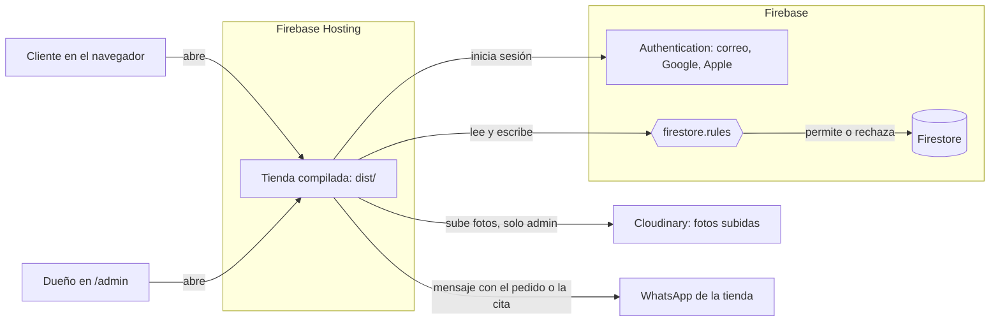
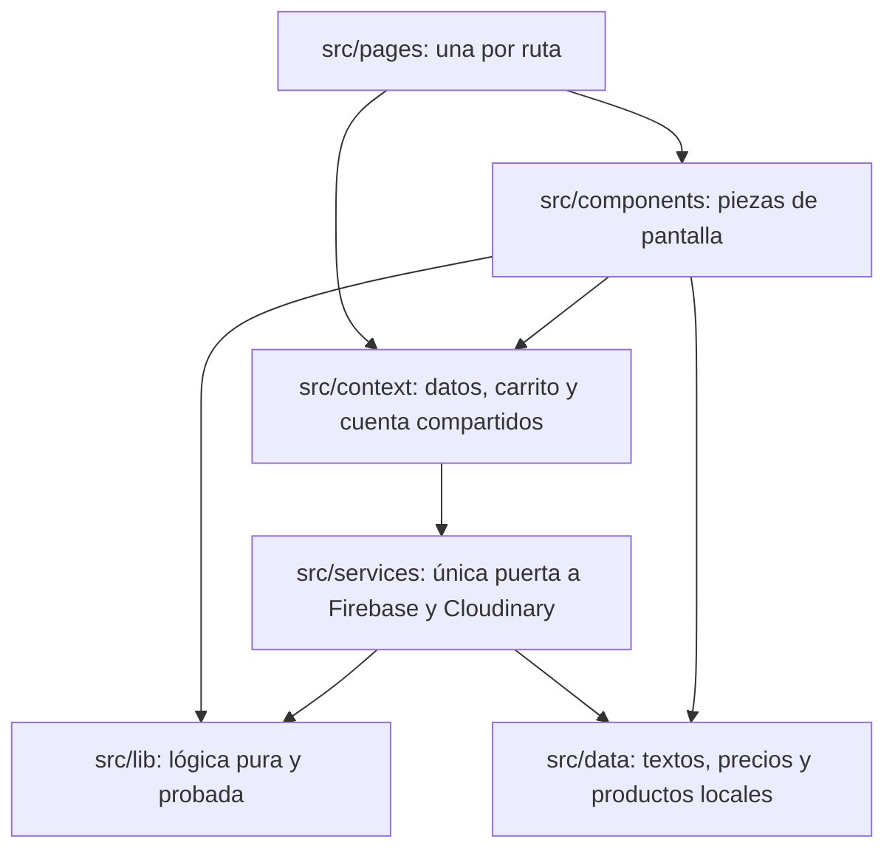
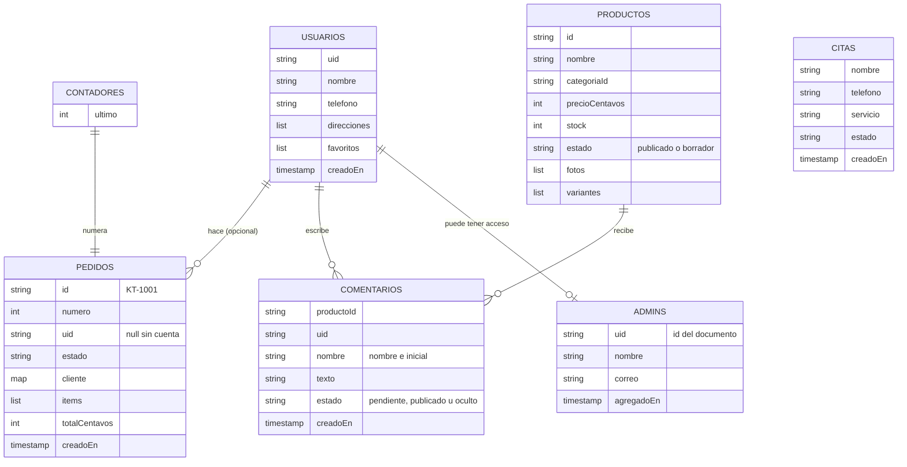
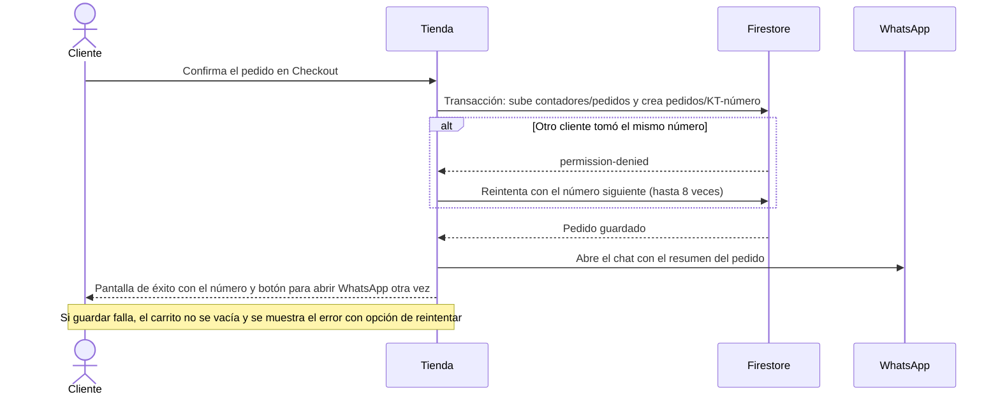
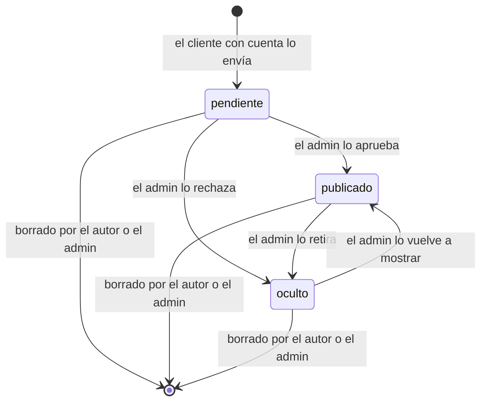

# Arquitectura

La tienda es una aplicación de una sola página (SPA) en React. No tiene servidor propio: el navegador habla directo con Firebase, y las reglas de Firestore deciden qué puede leer o escribir cada persona.

## Vista general

## Capas del código

| Carpeta | Qué hay |
| --- | --- |
| `src/pages` | Inicio, Catálogo, Producto, Carrito, Checkout, Aroma, Anime, Reparaciones, Ayuda, Contacto, Legal, Cuenta, Admin y 404 |
| `src/components/admin` | Panel: productos, pedidos, citas, clientes y comentarios |
| `src/components/cuenta` | Acceso, Mis pedidos, perfil, favoritos, direcciones y seguridad |
| `src/components/tienda` | Tarjetas, detalle, carrito, comentarios y precios |
| `src/components/ui` | Piezas reutilizables: fotos, campos, esqueletos de carga, pantallas de estado |
| `src/components/layout` | Encabezado, pie, navegación móvil, límite de errores y aviso de conexión |
| `src/context` | `DatosContext` (productos), `CarritoContext`, `CuentaContext` |
| `src/services` | `tienda.js` decide si los datos vienen de Firestore o de `src/data/` |
| `src/lib` | Totales, validaciones, armado de pedidos y citas, formato de precios |
| `src/data` | Textos de la tienda, tarifas, productos y textos legales |
| `tests/` | Pruebas de lógica; `tests/reglas/` prueba `firestore.rules` |
| `public/` | Archivos que se copian tal cual: logo, fuentes, íconos, `robots.txt`, `sitemap.xml` |
| `Productos/`, `reparaciones/` | Fotos originales de productos y servicios |

La compilación (`scripts/compilar.mjs`) va a `dist/`, que es lo que publica Firebase Hosting, o a `_pages/` para GitHub Pages. Copia las fotos livianas (`web/`) y genera `sitemap.xml` y `robots.txt` con `SITIO.url`. Los originales de las fotos, el código fuente y las pruebas no se publican.

## Base de datos

Los precios se guardan en centavos (enteros) para evitar errores de redondeo.

## Flujo de un pedido

Después, el dueño cambia el estado en `/admin > Pedidos` (recibido, confirmado, enviado, entregado o cancelado) y el cliente con cuenta lo ve en Mis pedidos.

## Flujo de un comentario

Solo los comentarios `publicado` se ven en la tienda. Al eliminar su cuenta, el cliente borra todos sus comentarios.

## Rutas

| Ruta | Página |
| --- | --- |
| `/` | Inicio |
| `/tecnologia/:categoria?` | Catálogo |
| `/buscar/:q?` | Búsqueda |
| `/producto/:slug` | Detalle del producto |
| `/carrito`, `/checkout` | Carrito y compra |
| `/aroma` | Aroma (perfumes). Muestra "Próximamente" hasta que haya productos en la categoría `aroma` |
| `/anime` | Zona Anime |
| `/reparaciones` | Servicios y citas |
| `/ayuda/:seccion?` | Preguntas frecuentes |
| `/contacto` | Canales de contacto |
| `/legal/:doc?` | Privacidad, términos, envíos y devoluciones |
| `/cuenta/:seccion?/:id?` | Cuenta del cliente |
| `/admin` | Panel de administración |

Las rutas no usan `#`. Firebase Hosting responde `index.html` a cualquier ruta (`rewrites` en `firebase.json`) y por eso `vite.config.js` usa `base: '/'`: con rutas relativas, recargar `/producto/x` buscaría los archivos en `/producto/assets/`.

## Sistema visual

Manual de marca del dueño (noviembre 2026). Los tokens viven en `src/styles/tokens.css` y `tests/contraste.test.js` verifica cada par texto/fondo y las combinaciones permitidas del manual.

- **Paleta (solo esta):** naranja Kirei `#F7931E` (hover `#E5850F`), azul marino `#0B1F33` (medio `#16324F`, noche `#071524`), negro `#111111`; neutros blanco, papel `#F7F5F1`, arena `#EFECE6`, borde `#DDD8CF`, gris texto `#4A4A4A`, gris lema `#666666`; apoyo durazno `#FDEBD3`, cobre `#9A5200`, niebla `#B7C4D3`, hielo `#E4E9EF`, plata `#D8D8D8`; estados éxito, error, info y aviso. Nada de verde, morado, ciruela ni dorado.
- **Proporción 60-30-10:** neutros de fondo, azul marino de marca, naranja solo en botones principales, precios y detalles. Botón naranja con texto negro (nunca blanco). Texto naranja chico sobre fondo claro: cobre.
- **Tipografía:** solo Poppins. 600 en títulos y botones, 400 en textos, 300 en frases grandes.
- **Temas por sección** (una clase en el contenedor que remapea los tokens de rol):
  - `tema-taller` (Reparaciones): marino noche, acentos naranja, texto blanco y niebla.
  - `tema-aroma` (Aroma): papel y durazno, títulos en marino, líneas y etiquetas en cobre, tarjetas blancas con borde fino y la foto sobre arena.
- **Excepciones a propósito:** el logo de Google en el botón de acceso conserva sus colores oficiales, y los marcos metálicos de los teléfonos de la portada y los materiales de la laptop 3D son materiales del dibujo, no colores de marca.
- **Imagen para compartir:** `scripts/og/og.html` con fotos reales (tecnología, perfumes y reparación); se regenera con `node scripts/og/generar.mjs`.

## Portada y entrada de las páginas

La portada (`src/pages/Inicio.jsx`) presenta lo que Kirei hace y vende; los productos y los precios viven en cada sección (`/tecnologia`, `/aroma`, `/anime`).

- `HeroKirei`: título grande y dos móviles inclinados (`TelefonosHero`, hechos en CSS, con la interfaz de la tienda en la pantalla).
- `QueHacemos`: Tecnología, Reparaciones, Aroma y Anime.
- `Conceptos`: Reparación, Mejoras y Tienda en tres filas tipográficas grandes. La laptop en 3D no está en la portada: vive solo en `/reparaciones`.
- `Aparece` (`src/components/ui`): la entrada de marca (sube desde un desenfoque de 8 px, escalonada 0,15 s). La usan las cabeceras de todas las páginas.

Para agregar otra sección de la tienda (por ejemplo, otra línea de productos): una entrada en `SECCIONES` y otra en `CATEGORIAS` de `src/data/catalogos.js`, un archivo de página como `src/pages/Aroma.jsx`, la ruta en `src/App.jsx`, el enlace en `Header.jsx` y `NavMovil.jsx`, y la ruta en el sitemap de `scripts/compilar.mjs`.

## Laptop 3D del taller (`/reparaciones`)

`src/components/reparaciones/laptop/`, tres archivos con una responsabilidad cada uno:

- `secuencia.js`: el guion, datos puros. Qué pieza sale, hacia dónde (mm), cuándo sale y cuándo vuelve. `estado(t)` devuelve la posición de todo en el segundo `t`. No importa three, así que se prueba en `tests/taller-aroma.test.js`.
- `escena.js`: three. Carga `public/modelos/laptop.glb`, pone luz de estudio (`RoomEnvironment`), aplica el estado a los nodos por nombre y mueve la cámara. Es el único archivo que importa three y se carga con `import()` cuando la sección se acerca a la pantalla: el resto de la web no lo descarga.
- `LaptopTaller.jsx`: el componente. Reproduce el guion solo y en bucle, sin controles (el dueño los pidió fuera). La pantalla se enciende con el logo de Kirei (`public/marca/kirei-logo-fondo-oscuro.svg`). Fuera de pantalla o con la pestaña oculta no dibuja. Con movimiento reducido arranca quieta en la vista desarmada. Si WebGL falla, deja un mensaje y los pasos en texto.

El orden del desarme es el real del equipo: cinco tornillos por debajo, sale la cubierta del teclado y debajo están batería, memoria, SSD, WiFi, disipador con ventilador, placa y altavoces.

**De dónde sale el modelo.** Chasis, pantalla, teclado (78 teclas), trackpad, tarjetas de expansión y batería (4 celdas) son el CAD oficial de Framework Laptop 13, publicado con licencia CC BY 4.0 (https://github.com/FrameworkComputer/Framework-Laptop-13). La licencia obliga a dar crédito: está en Términos, sección de propiedad intelectual (`src/data/textos.js`), y no se debe quitar de ahí. El CAD publicado no trae la placa ni lo que va sobre ella, así que placa base, CPU, disipador, ventilador, RAM, SSD, WiFi, altavoces y tornillos están modelados en `scripts/modelo3d/construir.py` con las medidas de sus estándares (SO-DIMM 69,6 x 30 mm, M.2 2280 y 2230) y la distribución del equipo real. No son una réplica de la placa de Framework y la web lo dice.

**Regenerar el modelo** (solo si se cambia): convertir los STEP del repositorio de Framework con `scripts/modelo3d/step2obj.cjs` (usa `occt-import-js`, que se instala aparte y no es dependencia del proyecto), correr `blender -b -P scripts/modelo3d/construir.py -- <carpeta> <salida.glb>` con Blender 5.3 y pasar el resultado por `gltf-transform optimize --compress quantize`. Se cuantiza y no se usa Draco ni Meshopt a propósito: sus descompresores son WebAssembly y la política de seguridad de `firebase.json` (`script-src 'self'`) los bloquearía.

## Aroma (`/aroma`)

Página propia (`src/pages/Aroma.jsx`, piezas en `src/components/aroma/`) con el tema `tema-aroma`: portada, familias olfativas, catálogo con filtro, ingredientes, recomendador y cierre.

- **Perfumes:** son productos de la categoría Aroma. Los 29 del dueño están en `src/data/productos.js`, con sus fotos en `perfumes/` (copias livianas con `scripts/fotos-web.ps1`, igual que `Productos/`) y sin precio hasta que lo mande: sin precio, su página pide consultar por WhatsApp y no deja agregarlos al carrito. En la tabla de datos llevan las filas `Familia` (Gourmand y dulces, Frutales, Florales, Frescas y acuáticas, Orientales y amaderadas), `Para` (Mujer u Hombre), `Tamaño` (por ejemplo `100 ml`) e `Intensidad` (Suave o Intensa, solo si la descripción lo dice). `datosPerfume` en `src/lib/aroma.js` las lee para los filtros y el recomendador. Los que se creen en `/admin` funcionan igual si llevan esas filas.
- **Portada (scroll):** `src/components/aroma/PortadaAroma.jsx`. Pista de 360svh con la escena fija: la caja de Kirei se abre y el frasco sube flotando, cuadro por cuadro según el scroll (`round(p * 119)`), y vuelve igual al subir; no se reproduce sola. Los textos ("AROMA.", la nota "Una primera impresión inesperada.", el cierre "Descubre tu esencia." con el botón a los perfumes) son HTML; su tramo de aparición está en `src/components/aroma/portada.js` y se prueba en `tests/taller-aroma.test.js`. Los 120 cuadros (WebP con transparencia) están en `public/aroma/frasco/`: los genera `scripts/modelo3d/perfume.py` en Blender 5.3 y los convierte `scripts/modelo3d/frasco-web.py`. Es un frasco decorativo de Kirei, no un producto en venta.
- **Sin foto:** un perfume sin foto se dibuja con `Frasco.jsx` (silueta, color de su familia e iniciales).
- **Recomendador:** `recomendar` puntúa cada perfume del catálogo visible con las cuatro respuestas y devuelve los de mayor puntaje. No hay azar.
- El ícono de Aroma (`src/components/ui/IconoAroma.jsx`) es el único propio; el resto son Bootstrap Icons.
