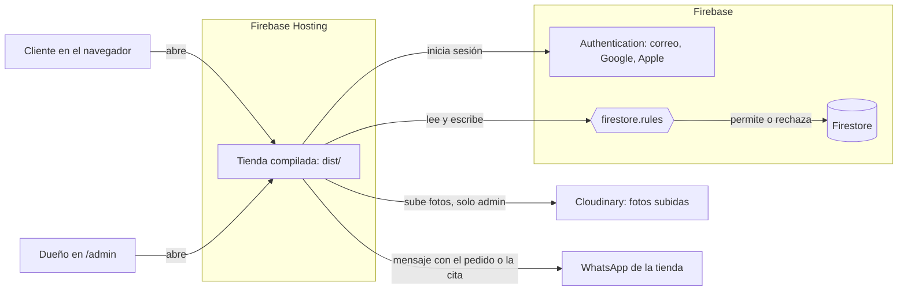
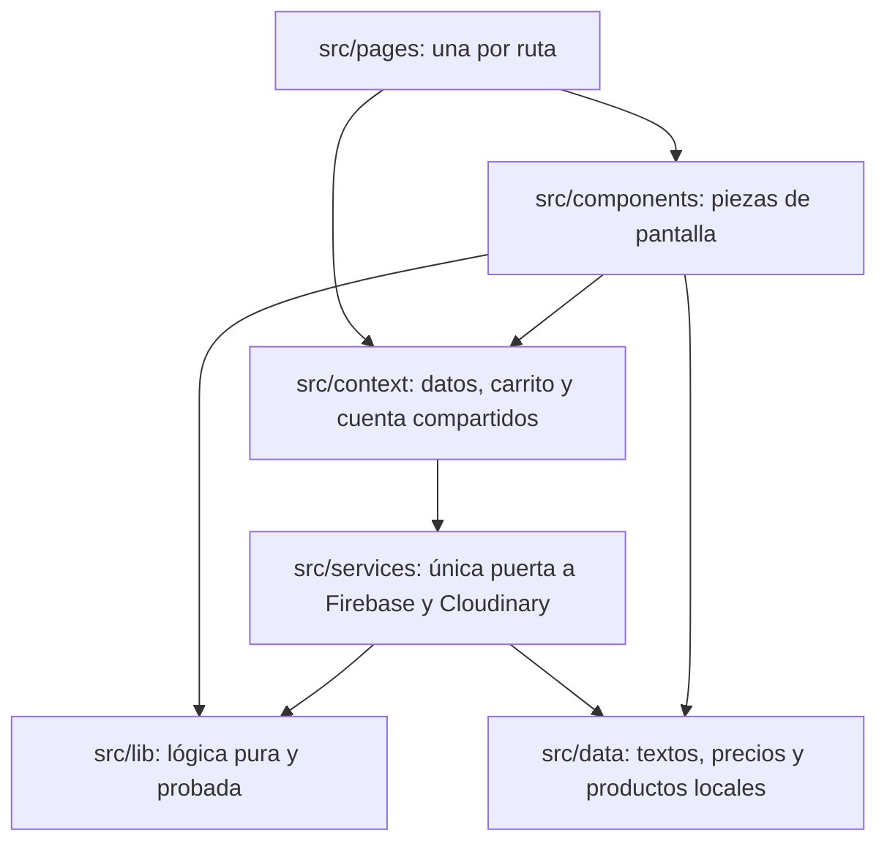
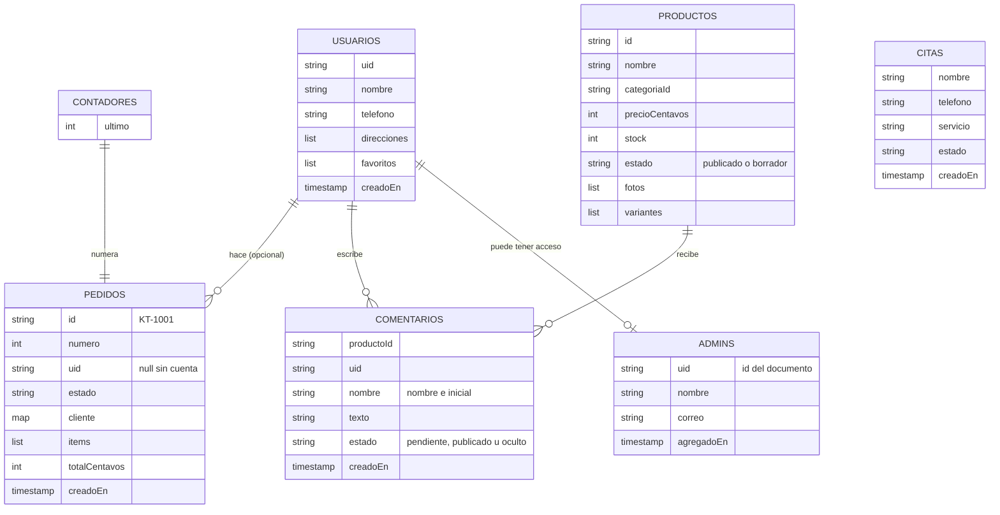
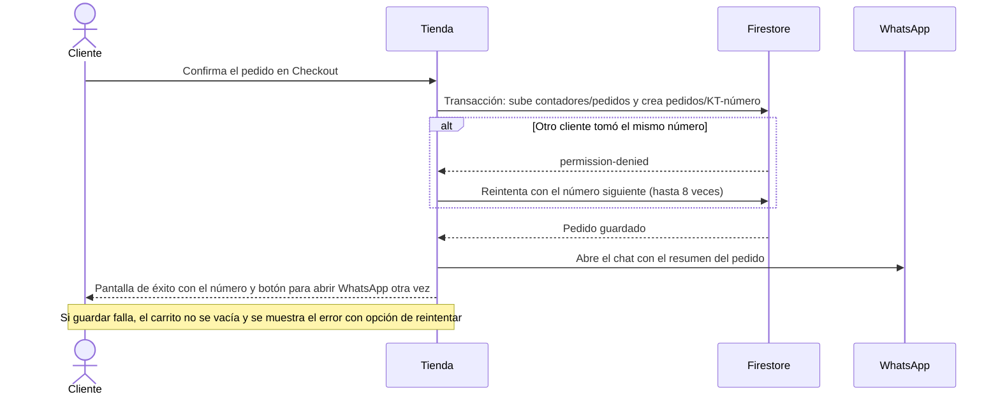
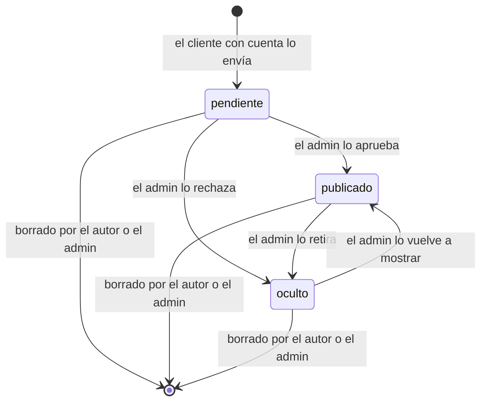

# Arquitectura

La tienda es una aplicación de una sola página (SPA) en React. No tiene servidor propio: el navegador habla directo con Firebase, y las reglas de Firestore deciden qué puede leer o escribir cada persona.

## Vista general

## Capas del código

| Carpeta | Qué hay |
| --- | --- |
| `src/pages` | Inicio, Catálogo, Producto, Carrito, Checkout, Aroma, Anime, Reparaciones, Ayuda, Contacto, Legal, Cuenta, Admin y 404 |
| `src/components/admin` | Panel: productos, pedidos, citas, clientes y comentarios |
| `src/components/cuenta` | Acceso, Mis pedidos, perfil, favoritos, direcciones y seguridad |
| `src/components/tienda` | Tarjetas, detalle, carrito, comentarios y precios |
| `src/components/ui` | Piezas reutilizables: fotos, campos, esqueletos de carga, pantallas de estado |
| `src/components/layout` | Encabezado, pie, navegación móvil, límite de errores y aviso de conexión |
| `src/context` | `DatosContext` (productos), `CarritoContext`, `CuentaContext` |
| `src/services` | `tienda.js` decide si los datos vienen de Firestore o de `src/data/` |
| `src/lib` | Totales, validaciones, armado de pedidos y citas, formato de precios |
| `src/data` | Textos de la tienda, tarifas, productos y textos legales |
| `tests/` | Pruebas de lógica; `tests/reglas/` prueba `firestore.rules` |
| `public/` | Archivos que se copian tal cual: logo, fuentes, íconos, `robots.txt`, `sitemap.xml` |
| `Productos/`, `reparaciones/` | Fotos originales de productos y servicios |

La compilación (`scripts/compilar.mjs`) va a `dist/`, que es lo que publica Firebase Hosting, o a `_pages/` para GitHub Pages. Copia las fotos livianas (`web/`) y genera `sitemap.xml` y `robots.txt` con `SITIO.url`. Los originales de las fotos, el código fuente y las pruebas no se publican.

## Base de datos

Los precios se guardan en centavos (enteros) para evitar errores de redondeo.

## Flujo de un pedido

Después, el dueño cambia el estado en `/admin > Pedidos` (recibido, confirmado, enviado, entregado o cancelado) y el cliente con cuenta lo ve en Mis pedidos.

## Flujo de un comentario

Solo los comentarios `publicado` se ven en la tienda. Al eliminar su cuenta, el cliente borra todos sus comentarios.

## Rutas

| Ruta | Página |
| --- | --- |
| `/` | Inicio |
| `/tecnologia/:categoria?` | Catálogo |
| `/buscar/:q?` | Búsqueda |
| `/producto/:slug` | Detalle del producto |
| `/carrito`, `/checkout` | Carrito y compra |
| `/aroma` | Aroma (perfumes). Muestra "Próximamente" hasta que haya productos en la categoría `aroma` |
| `/anime` | Zona Anime |
| `/reparaciones` | Servicios y citas |
| `/ayuda/:seccion?` | Preguntas frecuentes |
| `/contacto` | Canales de contacto |
| `/legal/:doc?` | Privacidad, términos, envíos y devoluciones |
| `/cuenta/:seccion?/:id?` | Cuenta del cliente |
| `/admin` | Panel de administración |

Las rutas no usan `#`. Firebase Hosting responde `index.html` a cualquier ruta (`rewrites` en `firebase.json`) y por eso `vite.config.js` usa `base: '/'`: con rutas relativas, recargar `/producto/x` buscaría los archivos en `/producto/assets/`.

## Sistema visual

Los tokens viven en `src/styles/tokens.css` y `tests/contraste.test.js` verifica cada par texto/fondo.

- **Global (toda la web):** papel `#F7F5F1`, azul marino `#0B1F33` como marca, naranja `#F7931E` como acción. Poppins para leer, Unbounded para títulos. Radios: controles redondos, tarjetas 14 px. No se cambia por sección.
- **Temas por sección:** una clase en el contenedor (`tema-taller`, `tema-aroma`) remapea los tokens de rol (`--accion`, `--marca`, `--foco`, `--fuente-display`) solo dentro de ese bloque. Los componentes no saben del tema: un `btn btn-accion` sale azul en el taller y ciruela en Aroma sin tocar su CSS.
  - `tema-taller` (Reparaciones: portada, laptop, conceptos): grafito `#0F1216` y azul puro `#0A6CFF` como único acento, sin degradados de color. Para texto chico se usa `--acento-texto` (`#4D94FF`), porque el azul de los botones no llega a 4.5:1 sobre grafito.
  - `tema-aroma` (Aroma): marfil `#F6F1E7`, champán `#E9D9BC`, ciruela `#4A1F3A` (marca y acción), negro `#141014`, dorado `#A8853A` solo para líneas. Títulos en serif (`Cormorant Garamond` si se instala; mientras tanto Georgia).
  - Anime no tiene tema propio: usa el global, con la tarjeta azul marino en la portada. Se decidió conservarla así.
- **Reglas:** un acento por sección; tarjetas solo cuando agrupan algo que se toca; sombras y degradados solo para profundidad real (el halo de la laptop), nunca de color a color; microinteracciones de 150 a 250 ms con `--ease-salida`; todo respeta `prefers-reduced-motion`.

## Portada y entrada de las páginas

La portada (`src/pages/Inicio.jsx`) presenta lo que Kirei hace y vende; los productos y los precios viven en cada sección (`/tecnologia`, `/aroma`, `/anime`).

- `HeroKirei`: título grande y dos móviles inclinados (`TelefonosHero`, hechos en CSS, con la interfaz de la tienda en la pantalla).
- `QueHacemos`: Tecnología, Reparaciones, Aroma y Anime.
- `LaptopDesarmable`: una laptop en 3D (solo CSS) que se desarma y se arma con el scroll. Una variable (`--e`, de 0 armada a 1 desarmada) mueve cada pieza con `calc()`. Con movimiento reducido queda desarmada y quieta. También se usa en `/reparaciones`.
- `Aparece` (`src/components/ui`): la entrada de marca (sube desde un desenfoque de 8 px, escalonada 0,15 s). La usan las cabeceras de todas las páginas.

Para agregar otra sección de la tienda (por ejemplo, otra línea de productos): una entrada en `SECCIONES` y otra en `CATEGORIAS` de `src/data/catalogos.js`, un archivo de página como `src/pages/Aroma.jsx`, la ruta en `src/App.jsx`, el enlace en `Header.jsx` y `NavMovil.jsx`, y la ruta en el sitemap de `scripts/compilar.mjs`.
